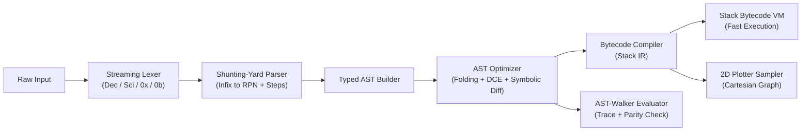

<div align="center">

# Scientific Expression Evaluator & Mini-Compiler Suite

**A high-performance C++20 expression compiler, AST optimizer, stack-based bytecode virtual machine, symbolic differentiation engine, and real-time 2D function plotter wrapped in a dark-mode Dear ImGui desktop workspace.**


-34D399?style=for-the-badge)

[Architecture](#compiler--execution-pipeline) •
[Capabilities](#core-capabilities) •
[Desktop Workspace](#desktop-analytics-workspace) •
[Functions & Grammar](#operators-constants--functions) •
[Quick Start](#build--run) •
[Project Structure](#project-structure)

</div>

---

## Compiler & Execution Pipeline

Every expression or multi-statement script flows through a modular multi-stage pipeline with microsecond-level profiling at each stage:



---

## Core Capabilities

### 1. Streaming Lexer (`Lexer.hpp/.cpp`)
- **Multi-Format Numeric Literals**: Standard integers & floats (`42`, `.25`), scientific notation (`1.5e-3`, `2E+4`), hexadecimal (`0xFF`, `0x1A`), and binary (`0b1010`).
- **Exact Source Mapping**: Every `Token` tracks 1-based `line`, `column`, `endColumn()`, `offset`, and `length` for pinpoint diagnostics and live highlighting.
- **Fault-Tolerant Highlighting**: Non-throwing `tokenizeForHighlighting()` preserves malformed literals (`0b102`, `3.14.15`, `@`) as `TokenType::Invalid` so the UI highlights errors directly inline.

### 2. Shunting-Yard Parser, AST Optimizer & Dead-Code Elimination (`Parser.hpp/.cpp`, `AST.hpp/.cpp`)
- **Stack-Based RPN Translation**: Converts infix expressions to Reverse Polish Notation while capturing step-by-step operator-stack and output-queue snapshots.
- **Optimization Passes**:
  - **Constant Folding**: Evaluates pure constant subtrees at compile time (`2 + 3 * 4` &rarr; `14`, `0x10 + 0b101` &rarr; `21`) while preserving error-raising subtrees (`1 / 0`, `sqrt(-1)`).
  - **Algebraic Identity Simplification**: Collapses `x + 0`, `x - 0`, `x * 1`, `x / 1`, `x ^ 1`, `+x`, and `--x`.
  - **Dead-Code & Dead-Store Elimination**: Eliminates unused pure expressions and overwritten redundant variable stores across multi-statement scripts.

### 3. Stack-Based Bytecode Virtual Machine (`BytecodeVM.hpp/.cpp`)
Compiles optimized ASTs into compact stack VM instructions and benchmarks execution against the recursive AST-walker:

| OpCode | Operand | Semantics |
| :--- | :--- | :--- |
| `PUSH` | `<double>` | Push numeric constant onto the VM operand stack |
| `LOAD` | `<symbol>` | Push local parameter or `SymbolTable` variable |
| `STORE` | `<symbol>` | Store top-of-stack into `SymbolTable` |
| `DEF_FUNC` | `<name(params)>` | Register parameterized user-defined function |
| `ADD` `SUB` `MUL` `DIV` `POW` `MOD` | — | Pop two operands, execute binary arithmetic, push result |
| `NEG` `POS` | — | Unary negation / identity on top-of-stack |
| `CALL` | `<name>, <arity>` | Invoke built-in `<cmath>`, `ndiff`, or user function |
| `POP` / `HALT` | — | Discard top value / return final evaluation result |

<details>
<summary><b>Example Bytecode Disassembly</b> — <code>f(x) = x^2 + 2*x + 1; f(4)</code></summary>

```text
Statement #1 (Function Definition):
0000  DEF_FUNC  f(x)
0001  HALT

Statement #2 (Call Evaluation):
0000  PUSH      4
0001  CALL      f, 1
0002  HALT
```

</details>

### 4. Symbolic & Numerical Differentiation (`SymbolicDiff`, `Evaluator`)
- **Symbolic Differentiation**: Computes exact algebraic derivatives via `diff(expr, var)` using power, exponential, product, quotient, and chain rules, then simplifies the resulting AST automatically:
  - `diff(x^2 + 2*x + 1, x)` &rarr; `2 * x + 2`
  - `diff(sin(2 * x), x)` &rarr; `cos(2 * x) * 2`
  - `diff(diff(x^3, x), x)` &rarr; `6 * x` (nested higher-order derivatives)
  - Works symbolically even when `x` has no numeric binding, or evaluates numerically when `x` is assigned.
- **Numerical Differentiation**: `ndiff(expr, var, x0)` evaluates central finite differences $(f(x_0 + h) - f(x_0 - h)) / (2h)$ for arbitrary functions.

### 5. Thread-Safe Symbol Table & Diagnostics (`SymbolTable`, `CompilerException`)
- **Concurrent Safety**: `SymbolTable` uses `std::shared_mutex` (`std::shared_lock` for concurrent reads, `std::unique_lock` / `std::scoped_lock` for writes and transactional atomic script commits).
- **Structured Caret Diagnostics**: Custom exception hierarchy (`LexicalException`, `SyntaxException`, `UnbalancedParenthesesException`, `SemanticException`, `UndeclaredVariableException`, `UnknownFunctionException`, `ArityMismatchException`, `DivisionByZeroException`, `MathDomainException`) with call-stack unwinding and exact caret pointers:

```text
[SyntaxError / E_UNBALANCED_PARENS] Line 1, Col 5..5: Unclosed opening parenthesis '(' — missing matching ')'
  5 + (3 * 2
      ^
  Hint: Add a closing ')' at the end of the parenthesized expression.
```

---

## Desktop Analytics Workspace

Built with **Dear ImGui + GLFW + OpenGL3** in a sleek dark studio theme with Windows dark titlebar support and automatic DPI scaling:

```text
┌──────────────────────────────────────────────────────────────────────┬──────────────────────────┐
│ SCIENTIFIC EXPRESSION EVALUATOR   [Sample Presets]  [Keypad][2D Plot]│ MEMORY & SYMBOL INSPECTOR│
├──────────────────────────────────────────────────────────────────────┤                          │
│ Command & Expression Editor (Syntax Highlighting + Autocomplete)     │  Name   Value   Kind     │
│ Real-Time Result (Auto / Fixed / Sci / Frac) + Microsecond Profiler  │  pi     3.14159 Const    │
├──────────────────────────────────┬───────────────────────────────────┤  e      2.71828 Const    │
│ EXECUTION PIPELINE INSPECTOR     │ LIVE 2D FUNCTION PLOTTER          │  phi    1.61803 Const    │
│  [Token Stream] [Visual AST]     │  y = sin(x) + 0.25 * x^2          │  x      2.5     User     │
│  [Bytecode VM]  [Shunting-Yard]  │  Interactive Pan / Zoom / f'(x)   │                          │
│  [Profiler & Trace]              │  Live Crosshair (x, y) Readout    │ USER FUNCTIONS           │
│                                  │                                   │  f(x) = x^2 + 2*x + 1    │
├──────────────────────────────────┴───────────────────────────────────┴──────────────────────────┤
│ DIAGNOSTIC CONSOLE   [0 Errors]                                                                 │
│  [14:15:10] f(x) = sin(x) + 0.25 * x^2; f(pi / 2)  =>  1.61685                                  │
└─────────────────────────────────────────────────────────────────────────────────────────────────┘
```

- **Command & Expression Editor**: Multi-line/single-line editing (`Enter` evaluates, `Ctrl+Enter` inserts newline), clickable autocomplete chips, expression history, sample presets, and toggleable scientific keypad.
- **Result Formatting**: Toggle instantaneously between **Auto**, **Fixed** (`0..15` decimal places), **Scientific**, and **Fractional** (Stern-Brocot continued-fraction approximator, e.g. `0.3333333333` &rarr; `1/3`, `pi` &rarr; `~355/113`).
- **Live 2D Function Plotter**: Compiles expressions once into VM bytecode, plots over `[xMin, xMax]`, splits curves cleanly across discontinuities/asymptotes (`sqrt(x)`, `1/x`, `tan(x)`), overlays symbolic `f'(x)`, and supports drag-pan, scroll-zoom, and crosshair inspection.
- **Visual AST & Shunting-Yard Scrubber**: Pan-and-zoom 2D AST node graph + hierarchy tree + step-by-step Shunting-Yard player (`|<<`, `< Prev`, `Play`, `Next >`, `>>|`).

---

## Operators, Constants & Functions

### Operator Precedence & Associativity

| Precedence | Operators | Associativity | Description |
| :---: | :--- | :--- | :--- |
| `4` | `^` | Right | Exponentiation (`2^3^2 = 512`) |
| `3` | `u-`, `u+` | Right | Prefix unary negation / plus (`-2^2 = -4`, `2^-3 = 0.125`) |
| `2` | `*`, `/`, `%` | Left | Multiplication, division, floating-point modulo |
| `1` | `+`, `-` | Left | Addition, subtraction |
| `0` | `=` | Right | Variable assignment & function definition |

### Built-in Constants & Functions

- **Constants**: `pi` ($\pi \approx 3.14159265$), `e` ($e \approx 2.71828183$), `phi` ($\varphi \approx 1.61803399$)
- **Math (`<cmath>`)**: `sin(x)`, `cos(x)`, `tan(x)`, `sqrt(x)`, `exp(x)`, `ln(x)`, `log(x)`, `log10(x)`, `pow(a, b)`, `abs(x)`
- **Calculus**: `diff(expr, var)`, `ndiff(expr, var, at_x)`
- **User Functions**: `f(x) = x^2 + 2*x + 1`, `hypot(a, b) = sqrt(a^2 + b^2)`

---

## Build & Run

### Prerequisites
- **C++20 Compiler**: MSVC 19.30+, GCC 11+, or Clang 14+
- **CMake 3.20+** (dependencies `GLFW 3.4`, `Dear ImGui`, and `Catch2` are fetched automatically via `FetchContent`)
- **OpenGL**: `opengl32` on Windows, `libgl1-mesa-dev` on Ubuntu/Debian

### Windows (Visual Studio Developer Command Prompt + Ninja)
```bat
cmake -S . -B build -G Ninja -DCMAKE_BUILD_TYPE=Release
cmake --build build
ctest --test-dir build --output-on-failure
build\MathCompilerGUI.exe
```

### Linux / macOS
```bash
cmake -S . -B build -DCMAKE_BUILD_TYPE=Release
cmake --build build -j
ctest --test-dir build --output-on-failure
./build/MathCompilerGUI
```

### Headless Core + Catch2 Tests Only
```bash
cmake -S . -B build -DBUILD_GUI=OFF -DBUILD_TESTS=ON -DCMAKE_BUILD_TYPE=Release
cmake --build build
ctest --test-dir build --output-on-failure --verbose
```

> **IDE / Language Server Support**: `CMakeLists.txt` enables `CMAKE_EXPORT_COMPILE_COMMANDS` and ships with `.clangd` pointing to `build/`, enabling zero-configuration C++20 IntelliSense in VS Code / clangd.

---

## Project Structure

<details>
<summary><b>View Modular Source Tree</b></summary>

```text
├── CMakeLists.txt                   # C++20 build configuration (-Wall -Wextra -pedantic / /W4)
├── .clangd                          # Language server configuration pointing to build/
├── .gitignore
├── README.md
├── src/
│   ├── core/
│   │   ├── SourceLocation.hpp       # Line/column spans & caret diagram builder
│   │   ├── CompilerException.hpp/.cpp # Custom exception hierarchy & stack unwind frames
│   │   ├── FunctionRegistry.hpp     # Built-in function & calculus metadata
│   │   ├── Token.hpp                # Token definitions, precedence & associativity
│   │   ├── Lexer.hpp/.cpp           # Decimal, scientific, hex (0x) & binary (0b) lexer
│   │   ├── SymbolTable.hpp/.cpp     # Thread-safe variable, constant & user function store
│   │   ├── MathOps.hpp/.cpp         # Domain-checked arithmetic & <cmath> primitives
│   │   ├── AST.hpp/.cpp             # Typed AST nodes, optimizer, DCE & symbolic diff
│   │   ├── Parser.hpp/.cpp          # Shunting-Yard parser & AST constructor
│   │   ├── BytecodeVM.hpp/.cpp      # Bytecode compiler, disassembler & stack VM
│   │   ├── Evaluator.hpp/.cpp       # AST-walking evaluator with step trace
│   │   ├── Plotter.hpp/.cpp         # Bytecode-backed 2D Cartesian curve sampler
│   │   └── CompilerEngine.hpp/.cpp  # Facade unifying compilation, VM & profiling
│   └── gui/
│       ├── Theme.hpp/.cpp           # Dark studio color palette & DPI-scaled fonts
│       ├── MainWindow.hpp/.cpp      # Editor, 2D plotter, inspector, profiler & console
│       └── main.cpp                 # GLFW + OpenGL3 application entry point
└── tests/
    └── CompilerTests.cpp            # Catch2 unit test suite (123 assertions, 7 test cases)
```

</details>
